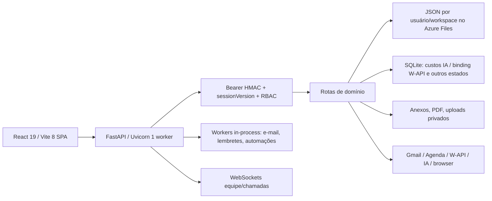

# Auditoria Pré-Lançamento do Norium

> Auditoria local de 16/09/2026. Branch `main`, commit `a8196d82620b867692203295e5b35130adbed8a7`. Código de produção: conforme declaração do responsável, igual ao checkout local; configuração, dependências instaladas, dados e operação de produção não foram verificados. Nenhum deploy ou alteração de dados reais foi realizado.

## 1. Resumo executivo

**Veredito: NO-GO para lançamento público hoje. Risco geral: alto.** Foram encontrados seis achados altos, doze médios, um baixo e um informativo. Nenhum vazamento entre clientes foi confirmado na matriz testada; dez verificações A/B tiveram o resultado esperado, incluindo negações e filtros de escopo. Isso não significa cobertura de todas as rotas, jobs, WebSockets e arquivos.

Os bloqueadores principais são a possibilidade de uma leitura substituir dados financeiros corrompidos por vazio (AUD-01), membros Equipe bloqueados no chat (AUD-02) e permissões financeiras administrativas gravadas mas ignoradas (AUD-03). Quota/limpeza de arquivos, reexecução de automações e recuperação completa também requerem resolução ou prova operacional antes de operação pública com dados empresariais. O risco de perda de dados, disponibilidade e efeitos externos duplicados é concreto nos caminhos descritos; comprometimento real ou incidente em produção não foi demonstrado.

Conforme informou o responsável durante a auditoria, a produção usa o mesmo código do checkout local. Isso torna os defeitos de código relevantes para a versão publicada. Ambiente, dependências, volumes, segredos, backups e serviços externos podem divergir; não foram inspecionados em produção por instrução explícita.

## 2. Arquitetura encontrada

### Mapa de componentes e fluxos

Frontend: React 19.2.7, TypeScript 6.0.3, Vite 8.1.0, Vitest 4.1.10 no lock; SPA por módulos lazy e cliente HTTP comum. Backend: FastAPI modular com dependências Python em `requirements.txt`, muitas sem pin, Uvicorn e Python 3.14 no Dockerfile. Azure Container Apps recebe imagem construída por GitHub Actions; Bicep configura uma réplica/worker, Azure File em `/app/data`, volume de 5 GiB e probes `/health`. CI executa lint, teste, build, SCA/SAST/Gitleaks, browser/media de chamadas e deploy por imagem. O runtime inicia workers no lifespan, sem fila externa geral evidenciada.

Sessão: HMAC assinado por sete dias, `sessionVersion` no cadastro global, revogado por logout/troca de senha. `current_user` confere usuário ativo, workspace do header contra workspaces ativos da conta e permissão/entitlement da rota. Equipe usa proprietário e membros por `teamOwnerId` (não há associação N:N geral). Dados principais usam JSON por usuário/workspace; conta compartilha algumas coleções; há SQLite em custos IA e binding W-API. Não há RLS relacional aplicável ao JSON. A ausência de FK obriga validações no domínio.

Fluxos críticos rastreados: (1) UI → bearer/workspace → `current_user` → cliente/tarefa/financeiro → arquivo JSON/privado; (2) Nora → permissão de IA → contexto autorizado e minimização → provedor → ledger de custos/resposta; (3) automação → evento/manual → executor → mensagem/IA/browser/tarefa/Gmail → histórico; (4) webhook W-API → segredo/instância/owner → deduplicação → store/chat; (5) documentos → proposta/contrato → PDF/arquivo → token HMAC de assinatura pública; (6) chamada → ticket efêmero/WebSocket → coordenador local e ICE/TURN.

Os módulos do backend incluem auth, platform, tasks, clients, finance/admin_finance, commercial, reports, calendar/mail, chat/whatsapp, team, automations, nora, intelligence, operations, workhub, brainstorm, public_site, inbox e system. Configuração requer, conforme recurso, segredo HMAC ou store persistente, chaves de provedores, OAuth redirect, W-API webhook/binding/criptografia, SMTP, TURN, URL pública e caminho de dados; inventário de 86 nomes referenciados em `output/auditoria-20260916/root/environment-names.json`. Nenhum valor de segredo foi lido.

## 3. Matriz de achados

A confiança **Confirmado** indica caminho demonstrado por probe local ou leitura integral sem bifurcação relevante; **Provável** indica caminho plausível ainda sem reprodução; **Risco a validar** exige evidência adicional do runtime/produto/operação. Bloqueio pode ser condicional ao recurso ou lançamento público, conforme texto.

| ID | Severidade | Confiança | Categoria | Achado | Bloqueia lançamento | Prioridade |
| --- | --- | --- | --- | --- | --- | --- |
| AUD-01 | Alta | Confirmado | Banco e perda de dados | Falha de leitura pode substituir dados financeiros por vazio | Sim | P0 |
| AUD-02 | Alta | Confirmado | Autorização e funcionalidade central | Membro criado pelo fluxo normal não recebe acesso ao chat da equipe | Sim, para lançamento de equipes | P0 |
| AUD-03 | Alta | Confirmado | Autorização administrativa | Permissões financeiras granulares não restringem administrador auxiliar | Sim, enquanto auxiliares ou controles granulares forem oferecidos | P0 |
| AUD-04 | Alta | Confirmado | Armazenamento e abuso | Uploads acumulam arquivos sem quota global ou coleta consistente | Sim, para uploads autenticados disponibilizados ao público sem controle de capacidade | P1 |
| AUD-05 | Alta | Confirmado | Integrações e idempotência | Retomada de automação pode repetir efeitos já concluídos | Sim, para oferecer retomada com efeitos externos | P1 |
| AUD-06 | Alta | Risco a validar | Backup e continuidade | Recuperação completa de dados não demonstrada | Sim, até existir evidência de recuperação completa | P1 |
| AUD-07 | Média | Confirmado | Integridade financeira | Financeiro administrativo aceita referências inexistentes | Sim para faturamento automatizado; não para piloto manual restrito | P1 |
| AUD-08 | Média | Confirmado | Confiabilidade | Idempotência interrompida não tem recuperação por lease | Sim para promessa de recuperação automática confiável | P1 |
| AUD-09 | Média | Confirmado | API e tratamento de erros | Rate limiting global responde 500 em vez de 429 | Não isoladamente | P2 |
| AUD-10 | Média | Confirmado | Produção e monitoramento | Readiness usa somente vivacidade do processo | Sim para operação pública com monitoramento de disponibilidade | P1 |
| AUD-11 | Média | Confirmado | Dependências e reprodutibilidade | Ambiente Python local diverge do manifesto e contém avisos conhecidos | Sim como evidência pendente do release; não afirma produção vulnerável | P1 |
| AUD-12 | Média | Confirmado | Privacidade e prontidão comercial | Políticas públicas e ciclo de exclusão estão incompletos | Sim para lançamento comercial público | P1 |
| AUD-13 | Média | Confirmado | Sessão e documentação | Token persiste em localStorage, divergindo da documentação | Não isoladamente, com política explícita aceita | P2 |
| AUD-14 | Média | Confirmado | Financeiro e regras de negócio | Catálogos comerciais e direitos de plano têm fontes divergentes | Sim para comercialização automática; piloto manual requer restrição explícita | P1 |
| AUD-15 | Informativa | Risco a validar | Arquitetura e desempenho | Escala horizontal e concorrência exigem validação adicional | Não para piloto de capacidade validada; sim para escalar horizontalmente | P3 |
| AUD-16 | Média | Risco a validar | Operação e deploy | Rollback e observabilidade operacional não têm comprovação completa | Sim enquanto não houver evidência operacional ou restrição formal do piloto | P1 |
| AUD-17 | Média | Risco a validar | Integração e segredos | Segredo de webhook em URL tem risco residual fora do aplicativo | Não sem evidência adicional | P2 |
| AUD-18 | Média | Provável | Ciclo de dados e isolamento de workspace | Formulários públicos podem sobreviver à remoção do workspace | Sim para oferecer remoção de workspace/formulários públicos sem ressalva | P1 |
| AUD-19 | Média | Provável | Documentos e múltiplos workspaces | Assinaturas públicas não carregam o workspace no token | Sim para disponibilizar assinatura pública em workspaces secundários sem validação | P1 |
| AUD-20 | Baixa | Confirmado | Manutenção e frontend | Concentração de código e bundles grandes elevam custo de mudança | Não isoladamente | P2 |

### Fichas de evidência e correção

#### AUD-01 — Falha de leitura pode substituir dados financeiros por vazio

**Severidade:** Alta · **Confiança:** Confirmado · **Categoria:** Banco e perda de dados · **Esforço:** Médio · **Prioridade:** P0 · **Bloqueia:** Sim.

**Localização:** `BE/app/infrastructure/persistence/json_repository.py:65-89; BE/app/services/finance_store.py:30-45,491-512; BE/app/modules/auth/router.py:603-609`.

**Evidência:** A leitura de JSON inválido, erro de I/O ou Unicode retorna fallback. No financeiro, list_finance normaliza esse fallback e grava um banco vazio. Prova sintética Astra: returned_entries=0 e file_overwritten_on_read=true. A corrupção foi introduzida deliberadamente apenas no arquivo descartável; não se demonstrou corrupção espontânea ou perda já ocorrida em produção.

**Impacto:** Uma leitura pode destruir a versão original recuperável após falha de armazenamento. Padrão análogo no cadastro global aumenta o alcance potencial.

**Como reproduzir com segurança:** Executar astra_probes.py em raiz descartável; criar lançamento fictício, tornar somente seu JSON inválido, chamar list_finance e comparar bytes antes/depois.

**Correção recomendada:** Distinguir ausente de ilegível/corrompido; falhar com erro controlado sem sobrescrever; preservar original, alertar e restaurar versão íntegra. Inicialização somente quando ausência estiver comprovada.

#### AUD-02 — Membro criado pelo fluxo normal não recebe acesso ao chat da equipe

**Severidade:** Alta · **Confiança:** Confirmado · **Categoria:** Autorização e funcionalidade central · **Esforço:** Médio · **Prioridade:** P0 · **Bloqueia:** Sim, para lançamento de equipes.

**Localização:** `BE/app/modules/auth/router.py:335-353,679-688,1047-1086; BE/app/modules/team/router.py:324-333`.

**Evidência:** Owner Equipe cria membro solicitando chat=True e equipe=True; create_user força plano individual e equipe=False. current_user exige equipe para /api/team-chat. Prova com store e token sintéticos retornou 403; a regra interna do chat aceita chat OU equipe.

**Impacto:** Colaboração e chamadas ficam indisponíveis para membros criados normalmente. Não é prova de escalada de privilégio; é incompatibilidade entre criação, entitlement e guard da rota.

**Como reproduzir com segurança:** No astra_probes.py, criar proprietário Equipe, cadastrar membro com chat habilitado e avaliar current_user real na rota /api/team-chat/members usando seu token.

**Correção recomendada:** Separar participação em chat/chamada de gerenciamento da equipe; alinhar plano do proprietário, permissão do membro e guard HTTP; validar cadastro→login→participação, mantendo administração negada.

#### AUD-03 — Permissões financeiras granulares não restringem administrador auxiliar

**Severidade:** Alta · **Confiança:** Confirmado · **Categoria:** Autorização administrativa · **Esforço:** Médio · **Prioridade:** P0 · **Bloqueia:** Sim, enquanto auxiliares ou controles granulares forem oferecidos.

**Localização:** `BE/app/modules/admin_finance/schemas.py:336-344; BE/app/modules/admin_finance/router.py:50-53,237-252,440-453; BE/app/modules/auth/router.py:305-323`.

**Evidência:** Flags view/managePayments/etc são persistidas, mas as rotas usam somente can_manage_system. Prova HTTP em memória: proprietário salvou todas as flags False (200); auxiliar criou pagamento (201). Pré-condição: conta já é administradora auxiliar; usuário comum não foi promovido.

**Impacto:** Restrições configuradas pela API não protegem leitura, alteração e exportação administrativas; dados financeiros podem ser manipulados por auxiliar supostamente restrito.

**Como reproduzir com segurança:** Executar astra_probes.py: PUT permissions com todas as flags falsas, depois POST payments como administrador auxiliar sintético.

**Correção recomendada:** Guard central por ação com negação por padrão; impedir autoelevação do auxiliar; cobrir leitura, escrita, importação, exportação e gestão das próprias permissões. Alternativa temporária: operação financeira somente pelo proprietário, com restrição efetiva no backend.

#### AUD-04 — Uploads acumulam arquivos sem quota global ou coleta consistente

**Severidade:** Alta · **Confiança:** Confirmado · **Categoria:** Armazenamento e abuso · **Esforço:** Médio · **Prioridade:** P1 · **Bloqueia:** Sim, para uploads autenticados disponibilizados ao público sem controle de capacidade.

**Localização:** `BE/app/services/nora_files.py:29-32,132-169,199-216; BE/app/modules/nora/router.py:509-512; BE/app/modules/intelligence/browser_runtime.py:191-250; BE/app/modules/intelligence/service.py:374; infra/azure/main.bicep:82-88`.

**Evidência:** Confirmado por inspeção integral: Nora grava o arquivo e mantém apenas 600 metadados, sem remover arquivos expulsos. Há limite de 24 MB por arquivo, mas não de bytes acumulados. Navegador limita uploads por execução, sem retenção global de execuções. O IaC define compartilhamento de 5 GiB. Probe de três arquivos de quatro bytes com MAX_FILES=2 foi preparado, mas não executado após bloqueio de aprovação.

**Impacto:** Arquivos órfãos, perda de acesso a uploads antigos e possível exaustão do volume compartilhado, afetando disponibilidade dos demais clientes. Não foi esgotado disco nem demonstrado incidente real.

**Como reproduzir com segurança:** Em diretório descartável, reduzir MAX_FILES somente por patch de teste e comparar três arquivos pequenos com dois registros no índice. Nunca testar com arquivos grandes em ambiente compartilhado.

**Correção recomendada:** Reservar quota cumulativa antes da escrita; impor limites por conta e globais; remover artefatos expirados com política explícita, conciliação e trilha; alertar capacidade e impedir novas gravações antes do esgotamento.

#### AUD-05 — Retomada de automação pode repetir efeitos já concluídos

**Severidade:** Alta · **Confiança:** Confirmado · **Categoria:** Integrações e idempotência · **Esforço:** Grande · **Prioridade:** P1 · **Bloqueia:** Sim, para oferecer retomada com efeitos externos.

**Localização:** `BE/app/modules/automations/router.py:494-754,837-877,1057-1102; BE/app/modules/automations/events.py:128-143,181-205`.

**Evidência:** Confirmado por inspeção: mensagem é enviada antes de etapas posteriores; falha é registrada para a execução inteira. Reexecutar erro chama o executor desde o início. resumedFromStepId é registrado, mas não usado para pular efeitos concluídos. O worker evita retry automático, porém a reexecução manual não tem checkpoint por efeito. Probe com fakes preparado, não executado por limite da aprovação.

**Impacto:** WhatsApp/e-mail/chat duplicados, tarefas repetidas e ações externas repetidas após falha parcial. Nenhuma mensagem real foi enviada na auditoria.

**Como reproduzir com segurança:** Usar envio fake que conta chamadas, provocar falha na etapa seguinte e chamar a rota de reexecução; o teste preparado espera duas chamadas do envio.

**Correção recomendada:** Persistir estado e chave idempotente por etapa; retomar somente efeitos não concluídos; conciliar resultado remoto incerto antes de reenviar; mostrar efeitos já realizados ao usuário.

#### AUD-06 — Recuperação completa de dados não demonstrada

**Severidade:** Alta · **Confiança:** Risco a validar · **Categoria:** Backup e continuidade · **Esforço:** Médio · **Prioridade:** P1 · **Bloqueia:** Sim, até existir evidência de recuperação completa.

**Localização:** `BE/app/modules/operations/router.py:339-357; infra/azure/main.bicep; infra/azure/restore_local_data.py; docs/ai-costs.md:33-35`.

**Evidência:** Exportação /backup inclui somente *.json do workspace e redige credenciais. Prova com anexo e subworkspace gerou ZIP só com perfil_db.json. Não inclui toda a raiz, arquivos privados, SQLite e metadados de conta. O repositório tem utilitário de restauração/migração e snapshot pontual, mas o IaC revisado não define política completa de backup/retensão. Nenhum ensaio completo de restauração foi executado. Isso não prova inexistência de backup configurado manualmente fora do repositório.

**Impacto:** Uma pane/corrupção pode produzir perda irrecuperável. Exportação de usuário não pode ser tratada como backup operacional restaurável.

**Como reproduzir com segurança:** root_checks.py cria perfil/anexo/subworkspace sintéticos e inspeciona o ZIP. Em homologação separada, futura validação deve restaurar JSON, SQLite, anexos e credenciais com consistência, hashes e login.

**Correção recomendada:** Definir RPO/RTO, cópia independente e consistente, criptografia, retenção e monitoramento; ensaiar restauração integral com o VFS correto do SQLite antes de aceitar dados valiosos.

#### AUD-07 — Financeiro administrativo aceita referências inexistentes

**Severidade:** Média · **Confiança:** Confirmado · **Categoria:** Integridade financeira · **Esforço:** Médio · **Prioridade:** P1 · **Bloqueia:** Sim para faturamento automatizado; não para piloto manual restrito.

**Localização:** `BE/app/modules/admin_finance/router.py:207-224,237-252; BE/app/modules/admin_finance/schemas.py:119-174`.

**Evidência:** Prova HTTP sintética persistiu pagamento com customerId, subscriptionId e planId inexistentes, retornando 201. Persistência JSON não possui FK; validação equivalente não é aplicada nesse fluxo.

**Impacto:** Registros órfãos e inconsistência em relatórios, receita e conciliação. Nenhuma cobrança externa foi testada ou realizada.

**Como reproduzir com segurança:** No astra_probes.py, POST payments autorizado com IDs inexistentes, seguido de inspeção do resultado sintético.

**Correção recomendada:** Validar existência e relação coerente entre cliente/plano/assinatura; regras explícitas de exclusão; transação de alteração e auditoria; identificar órfãos em cópia de dados antes de migrar.

#### AUD-08 — Idempotência interrompida não tem recuperação por lease

**Severidade:** Média · **Confiança:** Confirmado · **Categoria:** Confiabilidade · **Esforço:** Médio · **Prioridade:** P1 · **Bloqueia:** Sim para promessa de recuperação automática confiável.

**Localização:** `BE/app/infrastructure/reliability/idempotency.py:40-112; BE/app/bootstrap.py:279-343`.

**Evidência:** begin_request grava processing; registro existente é consultado antes da limpeza. Ausência de complete_request mantém processing. Probe envelheceu createdAt para o ano 2000 e a mesma chave continuou processing, com outbox pendente. Limpeza de dois dias depende de novas inserções.

**Impacto:** Retries ficam presos em conflito/processamento após interrupção. Usar chave nova sem conciliar pode duplicar um efeito já realizado.

**Como reproduzir com segurança:** root_checks.py inicia uma chave, não completa, envelhece apenas o registro fictício e tenta a mesma chave novamente.

**Correção recomendada:** Lease e estados de resultado desconhecido/recuperável; reconciliar efeito com evidência de domínio antes de liberar nova tentativa; processar outbox com observabilidade e política explícita.

#### AUD-09 — Rate limiting global responde 500 em vez de 429

**Severidade:** Média · **Confiança:** Confirmado · **Categoria:** API e tratamento de erros · **Esforço:** Pequeno · **Prioridade:** P2 · **Bloqueia:** Não isoladamente.

**Localização:** `BE/app/bootstrap.py:275-279; BE/app/core/rate_limit.py:19-33`.

**Evidência:** O limiter lança HTTPException fora do tratamento adequado do middleware. Probe HTTP reduziu apenas o limite em memória para 1: primeiro login inválido=401, seguinte=500, sem Retry-After.

**Impacto:** Cliente recebe erro interno em situação esperada, pode repetir indevidamente e a telemetria não descreve a causa. A rejeição existe; não foi demonstrado bypass do limite ou brute force ilimitado.

**Como reproduzir com segurança:** root_checks.py usa uma instância de limiter com limite 1 em teste, duas requisições sintéticas e inspeciona status/headers.

**Correção recomendada:** Retornar JSONResponse 429 no middleware com Retry-After, finalização do contexto e telemetria; testar fronteira HTTP completa.

#### AUD-10 — Readiness usa somente vivacidade do processo

**Severidade:** Média · **Confiança:** Confirmado · **Categoria:** Produção e monitoramento · **Esforço:** Pequeno · **Prioridade:** P1 · **Bloqueia:** Sim para operação pública com monitoramento de disponibilidade.

**Localização:** `BE/app/modules/system/router.py:34-40; infra/azure/main.bicep:166-189; Dockerfile.azure:53-54`.

**Evidência:** /health retorna ok sem verificar dependências. O mesmo caminho é usado para liveness e readiness. Probe com NORIUM_DATA_DIR inválido continuou 200. /health/browser é cacheado e prova Chromium, não integridade da persistência.

**Impacto:** Instância pode receber tráfego enquanto dados não podem ser gravados/lidos. Liveness simples é legítima; a lacuna é usá-la também como readiness de armazenamento.

**Como reproduzir com segurança:** root_checks.py troca o caminho de dados no processo de teste por arquivo não-diretório e consulta /health.

**Correção recomendada:** Endpoint separado de readiness com verificação limitada de dependências críticas e espaço, sem dados sensíveis; alertas de falha e latência; manter liveness leve.

#### AUD-11 — Ambiente Python local diverge do manifesto e contém avisos conhecidos

**Severidade:** Média · **Confiança:** Confirmado · **Categoria:** Dependências e reprodutibilidade · **Esforço:** Médio · **Prioridade:** P1 · **Bloqueia:** Sim como evidência pendente do release; não afirma produção vulnerável.

**Localização:** `BE/requirements.txt; Dockerfile.azure:26-27; .github/workflows/azure-container-apps.yml:35-56; output/auditoria-20260916/root/pip-audit.json`.

**Evidência:** pip-audit --local: 18 registros em cinco pacotes, equivalentes a nove CVEs únicos. Venv: aiohttp 3.14.1, cryptography 49.0.0, pip 26.1.2, pyasn1 0.6.3 e PyNaCl 1.5.0. requirements exige cryptography 50.0.0 e deixa várias outras dependências sem pin. pip check passa porque valida coerência dos pacotes instalados, não aderência ao manifesto. Código igual em produção não comprova dependências iguais.

**Impacto:** Resultados locais não reproduzem necessariamente o container e resoluções futuras podem mudar. A existência de versão afetada não confirma caminho explorável no Norium; por exemplo, aviso PKCS7 não comprova falha em Fernet.

**Como reproduzir com segurança:** Consultar pip-audit --local e comparar importlib.metadata/manifesto; deduplicar aliases. Não executar exploits.

**Correção recomendada:** Gerar lock/constraints verificáveis por plataforma, reconstruir ambiente descartável a partir do manifesto após autorização, auditar dependências runtime realmente embarcadas e guardar SBOM/resultado associado ao digest da imagem.

#### AUD-12 — Políticas públicas e ciclo de exclusão estão incompletos

**Severidade:** Média · **Confiança:** Confirmado · **Categoria:** Privacidade e prontidão comercial · **Esforço:** Médio · **Prioridade:** P1 · **Bloqueia:** Sim para lançamento comercial público.

**Localização:** `FE/src/components/public/LegalPage.tsx:6-36; BE/app/modules/auth/router.py:1173-1189; BE/app/modules/platform/service.py:102-112`.

**Evidência:** A própria página informa que dados da empresa, bases, prazos, canal e condições precisam ser definidos/revisados. DELETE usuário apenas inativa; delete_workspace remove a referência, não os dados físicos. Não foi identificado procedimento operacional completo e testado de atendimento ao titular no escopo revisado.

**Impacto:** Entrega comercial e governança de dados incompletas; retenção indefinida e solicitações sem processo demonstrado. É achado de produto/processo, não conclusão de infração legal.

**Como reproduzir com segurança:** Abrir LegalPage no código/interface e rastrear DELETE até a persistência; verificar se há procedimento documentado de exportação, retenção, exclusão e restauração.

**Correção recomendada:** Definir política com responsável jurídico/privacidade, finalidade e fornecedores; canal e fluxo verificável de solicitações; exclusão/anonimização seletiva e retenções justificadas, incluindo backups e integrações.

#### AUD-13 — Token persiste em localStorage, divergindo da documentação

**Severidade:** Média · **Confiança:** Confirmado · **Categoria:** Sessão e documentação · **Esforço:** Médio · **Prioridade:** P2 · **Bloqueia:** Não isoladamente, com política explícita aceita.

**Localização:** `FE/src/app/hooks/useAuthSession.ts:25-32,44-49; FE/src/core/api/config.ts:44-46; BE/app/core/security.py:21; SECURITY.md; docs/SECURITY_CONTROLS.md`.

**Evidência:** updateSession grava localStorage e remove sessionStorage; restauração migra o token para localStorage. Bearer tem validade de sete dias. Documentos descrevem sessionStorage e ausência de persistência. Logout revoga sessionVersion; probe de isolamento confirmou token revogado=401.

**Impacto:** Sessão permanece após fechamento do navegador, relevante em computador compartilhado. Código JavaScript da origem pode ler token; não foi demonstrado XSS nem roubo de sessão.

**Como reproduzir com segurança:** Inspecionar armazenamento após login local e reabrir navegador/perfil de teste; comparar comportamento com política documentada.

**Correção recomendada:** Definir requisito de duração/lembrar sessão, alinhar implementação e documentos, considerar sessão HttpOnly/CSRF conforme arquitetura e reautenticação sensível; manter revogação real.

#### AUD-14 — Catálogos comerciais e direitos de plano têm fontes divergentes

**Severidade:** Média · **Confiança:** Confirmado · **Categoria:** Financeiro e regras de negócio · **Esforço:** Médio · **Prioridade:** P1 · **Bloqueia:** Sim para comercialização automática; piloto manual requer restrição explícita.

**Localização:** `BE/app/modules/auth/router.py:140-172,1047-1086; BE/app/modules/admin_finance/repository.py:24-58; FE/src/components/auth/AuthScreen.tsx:16-21`.

**Evidência:** Catálogo de autenticação/onboarding usa 79/179/399 e assentos 8/50; seed financeiro usa 129/299/899 e 10/100. Fluxo create_user não consulta quota teamSeats/limits.users. Ativação de plano pago exige administração e isso é explícito na interface; não há prova de checkout automático funcional.

**Impacto:** Valores e limites inconsistentes podem gerar divergências comerciais, suporte e concessão excessiva de vagas. Configuração de limite de IA é mecanismo separado e não resolve assentos.

**Como reproduzir com segurança:** Comparar seeds/catálogos sem acessar clientes reais; rastrear criação de membro e ativação administrativa.

**Correção recomendada:** Fonte única versionada de planos, preços e entitlements; validar assentos na transação de criação/convite e especificar operação manual enquanto não houver cobrança integrada.

#### AUD-15 — Escala horizontal e concorrência exigem validação adicional

**Severidade:** Informativa · **Confiança:** Risco a validar · **Categoria:** Arquitetura e desempenho · **Esforço:** Grande · **Prioridade:** P3 · **Bloqueia:** Não para piloto de capacidade validada; sim para escalar horizontalmente.

**Localização:** `BE/app/infrastructure/persistence/json_repository.py:18-20,51-55,65-89,99-134; Dockerfile.azure:56; infra/azure/main.bicep:194-197; docs/SECURITY_CONTROLS.md`.

**Evidência:** Locks de caminho são locais ao processo, cobrem leitura/gravação individual, não toda transação universal. Estado de sockets/rate limit e vários locks são em memória. Deploy limita um worker/réplica. Cache tem 16 MiB/128 itens; arquivos JSON inteiros são carregados em múltiplos domínios.

**Impacto:** Adicionar réplicas/escritores pode introduzir atualização perdida e inconsistência de sessão/eventos. Não foi reproduzida corrida na topologia atual; o limite de uma réplica é mitigação consciente, mas restringe disponibilidade/capacidade.

**Como reproduzir com segurança:** Em futura homologação descartável, testar dois escritores na mesma entidade, crash/restart e volume equivalente ao esperado; medir perda de atualização e p95.

**Correção recomendada:** Manter uma réplica como restrição explícita; migrar gradualmente operações críticas para transações e pub/sub com tenant, somente após teste de concorrência. Não reescrever todo o sistema.

#### AUD-16 — Rollback e observabilidade operacional não têm comprovação completa

**Severidade:** Média · **Confiança:** Risco a validar · **Categoria:** Operação e deploy · **Esforço:** Médio · **Prioridade:** P1 · **Bloqueia:** Sim enquanto não houver evidência operacional ou restrição formal do piloto.

**Localização:** `.github/workflows/azure-container-apps.yml:342-355,419-440; BE/app/infrastructure/observability/diagnostics.py:11-13,50-97; BE/app/services/system_logs.py:18-19,65-84; infra/azure/team-call-alerts.yml`.

**Evidência:** CI guarda referência da imagem anterior e usa digest/uma revisão, mas não há passo de reversão automática nem evidência atual de ensaio. Métricas gerais são amostras em memória; logs locais têm limites de 10 mil registros/8 MiB. Há controles e alertas específicos de chamadas, cuja entrega externa não foi verificada. IaC revisado não comprova coleta geral/alerta/plantão.

**Impacto:** Falha de release ou degradação pode exigir intervenção manual sem tempo de recuperação conhecido. Logs no mesmo volume podem se perder com o incidente e retenção curta pode limitar investigação.

**Como reproduzir com segurança:** Revisar workflow e runbooks; futuro ensaio em homologação deve provocar falha controlada, receber alerta e voltar ao digest anterior com dados preservados.

**Correção recomendada:** Runbook de rollback executável, ensaio registrado, compatibilidade de dados/migração; coleta externa com redação, alertas acionáveis de erro/latência/disco/filas e responsável de plantão.

#### AUD-17 — Segredo de webhook em URL tem risco residual fora do aplicativo

**Severidade:** Média · **Confiança:** Risco a validar · **Categoria:** Integração e segredos · **Esforço:** Pequeno · **Prioridade:** P2 · **Bloqueia:** Não sem evidência adicional.

**Localização:** `BE/app/services/wapi_connect.py:146-175; BE/app/modules/chat/router.py:2197-2219; BE/app/bootstrap.py:90-131`.

**Evidência:** Callback usa query secret. Uvicorn já possui filtro que redige esse parâmetro e middleware registra apenas path. Não foram examinados logs/proxies/retensão do provedor, nem demonstrado vazamento. Segredo é comparado em tempo constante e instância/proprietário são validados.

**Impacto:** Se uma camada externa registrar URL integral sem redação, a credencial pode ficar exposta. A presença da credencial na configuração autorizada do provedor não é, por si só, vazamento.

**Como reproduzir com segurança:** Validar, em teste autorizado, contrato do provedor e redaction de toda a cadeia com segredo sintético; não chamar o webhook de terceiros.

**Correção recomendada:** Preferir assinatura/cabeçalho se suportados; caso contrário, redigir ponta a ponta, limitar acesso/retenção e rotacionar de forma coordenada. Não remover contrato sem validar compatibilidade.

#### AUD-18 — Formulários públicos podem sobreviver à remoção do workspace

**Severidade:** Média · **Confiança:** Provável · **Categoria:** Ciclo de dados e isolamento de workspace · **Esforço:** Médio · **Prioridade:** P1 · **Bloqueia:** Sim para oferecer remoção de workspace/formulários públicos sem ressalva.

**Localização:** `BE/app/modules/platform/service.py:102-112; BE/app/modules/platform/router.py:323-360`.

**Evidência:** Remover workspace exclui apenas sua referência. Rotas públicas percorrem user_*/**/plataforma_db.json e conferem token/active do formulário, sem verificar se o workspace ainda está ativo. Caminho foi identificado por leitura; não houve reprodução dinâmica dedicada.

**Impacto:** Um link público anteriormente válido pode continuar expondo formulário e recebendo dados em workspace removido. Não significa descoberta de tokens ou acesso irrestrito a outros tenants.

**Como reproduzir com segurança:** Criar formulário sintético em workspace secundário, guardar token, remover workspace e tentar GET/POST público local. Manter como provável até executar esse teste.

**Correção recomendada:** Revogar publicações ao arquivar/remover workspace; validar status de proprietário/workspace na resolução pública; indexar token com escopo e lifecycle, sem varredura de toda a raiz.

#### AUD-19 — Assinaturas públicas não carregam o workspace no token

**Severidade:** Média · **Confiança:** Provável · **Categoria:** Documentos e múltiplos workspaces · **Esforço:** Médio · **Prioridade:** P1 · **Bloqueia:** Sim para disponibilizar assinatura pública em workspaces secundários sem validação.

**Localização:** `BE/app/modules/commercial/service.py:2748-2759,2774-2780; BE/app/modules/commercial/repository.py:25-36; BE/app/core/tenant.py:97-106`.

**Evidência:** Token contém tenantId/contractId/signerId/exp, mas read_store resolve o arquivo usando workspace do contexto da requisição. A abertura pública sem header usa primary, mesmo se o contrato foi criado em workspace secundário. HMAC e expiração estão presentes. Não foi feita prova HTTP com contrato secundário.

**Impacto:** Link de assinatura gerado em workspace secundário pode falhar ou exigir contexto que o destinatário não possui. Não há evidência de falsificação de assinatura ou vazamento entre clientes.

**Como reproduzir com segurança:** Em teste, criar/enviar contrato no workspace secundário e abrir o link público sem X-Norium-Workspace; verificar resolução e isolamento do workspace primário.

**Correção recomendada:** Vincular workspace ao token assinado e resolver escopo explicitamente após validação; rejeitar contexto divergente e cobrir validade/revogação/assinatura sequencial em ambos os workspaces.

#### AUD-20 — Concentração de código e bundles grandes elevam custo de mudança

**Severidade:** Baixa · **Confiança:** Confirmado · **Categoria:** Manutenção e frontend · **Esforço:** Médio · **Prioridade:** P2 · **Bloqueia:** Não isoladamente.

**Localização:** `BE/app/modules/chat/router.py:1; BE/app/modules/commercial/service.py:1; FE/src/components/layout/Nora.tsx:1; FE/src/components/automations/AutomationsDashboard.tsx:1; FE/vite.config.ts`.

**Evidência:** Chat backend 5.416 linhas; comercial service 3.161; Nora frontend 2.533; useTeamCall 2.255; AutomationsDashboard 2.107. Build passou, mas index 1.098,34 KiB (314,97 gzip) e AdminDashboard 541,59 KiB (147,55 gzip) geraram aviso. Lint: 19 avisos. Busca lexical encontrou 228 ocorrências de any nas fontes, sem equivaler a 228 bugs; zero TODO/FIXME não prova completude.

**Impacto:** Acoplamento e arquivos extensos dificultam revisão de fronteiras, testes e manutenção; bundles podem atrasar carregamento em redes/dispositivos limitados. Não foi medido Core Web Vitals real.

**Como reproduzir com segurança:** Executar lint/build e inventário de linhas; analisar chunks em carga sintética de rede lenta antes de definir orçamento.

**Correção recomendada:** Extrair incrementalmente políticas/serviços/testes de fronteira; dividir código por rota e carregamento tardio; reduzir avisos de hooks com regressão funcional; definir orçamento mensurável de transferência e interatividade.

## 4. Cobertura funcional

Classificação conservadora: presença de UI/rota não equivale a fluxo validado. “Funcional e validada” está restrito ao recorte descrito na evidência.

| Módulo/fluxo | Estado encontrado | Evidência | Pendência |
| --- | --- | --- | --- |
| Login e logout | Funcional e validada no recorte local | Login incorreto mostrou erro; login sintético 200 e logout revogou token. | Validar sessão em navegadores e dispositivos adicionais. |
| Cadastro público | Parcialmente verificado por inspeção | Rotas e testes de código presentes; a jornada pública não foi exercitada no navegador. | Cadastro público e e-mail de verificação end-to-end pendentes. |
| Recuperação e verificação de e-mail | Não testada por falta de configuração/credencial | Rotas e worker existem; não foi entregue e-mail real. | Validar SMTP, expiracão, token único, entrega e reenvio em homologação. |
| Organizações, workspaces e membros | Parcialmente funcional | Workspace arbitrário foi negado 403; membro de equipe sintético recebeu 403 no chat (AUD-02). | Corrigir onboarding do membro e testar convite, remoção, múltiplos workspaces. |
| Papéis, permissões e admin | Com erro ou comportamento inconsistente | Planos são aplicados em API; permissões financeiras do auxiliar não restringem POST (AUD-03). | Teste integral de matriz por ação; bloquear auxiliar restrito. |
| Dashboard e navegação | Funcional e validada no recorte local | Smoke Chromium do build nas larguras 1440/390: rota, conteúdo, sem overflow ou erro JS. | Validar dados reais, carregamento sob latência e ações principais. |
| Projetos e tarefas | Parcialmente funcional | Tela e rota abriram em ambos viewports; listagem/autorização teste existente, sem CRUD visual completo; três botões sem nome detectados no estado vazio. | Criar/editar/excluir/anexar em navegador; identificar os três controles com acessibilidade real. |
| Agenda | Não testada por falta de configuração/credencial | API, UI e OAuth Google presentes; nenhuma conexão real exercitada. | Validar autorização, sincronização, token expirado e conflitos. |
| Clientes e arquivos | Funcional e validada no recorte local | Tela vazia responsiva; matriz HTTP A/B negou editar/anexo/download/delete de outro cliente. | Percorrer CRUD visual/upload válido, volume e exclusão. |
| Financeiro do usuário | Parcialmente funcional | Tela local responsiva; criação sintética ficou no tenant da sessão; corrupção deliberada destruiu JSON (AUD-01). | Corrigir falha de persistência, testar quitação/relatório/exportação. |
| Financeiro administrativo e assinatura comercial | Com erro ou comportamento inconsistente | Flags administrativas ignoradas (AUD-03), IDs financeiros órfãos aceitos (AUD-07); assinatura pública de workspace secundário não testada (AUD-19). | Ações reais, PDF/assinatura e conciliação exigem validação separada. |
| Documentos, propostas e ferramentas PDF | Parcialmente funcional | Tela de documentos abriu 1440/390 sem erro JS; geração/edição têm rotas e testes direcionados existentes, não houve fluxo completo nesta auditoria. | Importar→editar→gerar→baixar→assinar com conta A/B e PDF visual. |
| Gmail e inbox | Não testada por falta de configuração/credencial | OAuth state/PKCE/TTL observado no código; nenhum provedor acessado. | Credencial de teste, renovação, escopos, envio e falhas externas. |
| WhatsApp e chat central | Não testada por falta de configuração/credencial | Segredo, binding e deduplicação observados; sem W-API/contato real. | Conectar instância autorizada de homologação, webhook/out-of-order e expiração. |
| Chat/chamadas da equipe | Com erro ou comportamento inconsistente | Membro criado normalmente foi bloqueado no chat; CI anterior documenta quality gate de chamadas, porém nenhum teste de mídia real nesta auditoria. | Corrigir membro e repetir testes de chamadas/navegador com duas contas. |
| Notificações e e-mail transacional | Parcialmente funcional | Workers são iniciados no lifespan; UI de notificações existe; não ocorreu entrega real. | Falha/retry, preferências, deduplicação e alerta. |
| Relatórios e exportação | Parcialmente funcional | Rotas/geradores e testes existem; export /backup demonstrado incompleto como recuperação operacional. | Conferir métricas A/B, formatos, paginação e limites grandes. |
| Automações e Estúdio | Parcialmente funcional | Executor de automações tem efeitos reais no código; reexecução sem checkpoint (AUD-05). Estúdio tem rotas, sem sessão funcional completa. | Testar editor/salvar/versões e simular falhas por etapa com fakes. |
| Conhecimento e Nora | Parcialmente funcional | Controles de tenant/URL/guardrails presentes; upload Nora A/B negado 404; sem chamada a modelo real. | Validar respostas com documentos A/B, prompt injection e fontes. |
| Agente navegador | Não testada por falta de configuração/credencial | Allowlist DNS/redirecionamento/aprovação observada; nenhuma página externa visitada. | Fluxo browser com página local de teste e ações aprovadas. |
| Modelos/provedores/custos IA | Parcialmente funcional | Gateway e ledger presentes; ambiente sem chaves reais; venv diverge de requirements. | Troca real de provedor e tarifas, reservas concorrentes, limites. |
| Formulários públicos e portal | Risco a validar | Rotas públicas buscam tokens em disco; remoção de workspace só remove referência (AUD-18). | Provar lifecycle com formulário sintético de workspace secundário. |
| Interface responsiva e acessibilidade | Parcialmente funcional | 12 aberturas de rotas desktop/mobile, sem overflow/JS; três botões da tela vazia de tarefas sem nome via inspeção DOM; sem auditoria WCAG completa. | Teste teclado/leitor de tela, foco e nomes acessíveis nas principais telas. |

## 5. Resultados dos testes

| Gate | Resultado | Base |
| --- | --- | --- |
| Lint frontend | Passou com 19 avisos | Exit 0. |
| Typecheck e build | Passou | `tsc -b && vite build`; exit 0, 1.627 módulos. |
| Vitest frontend | Passou | 112 arquivos, 667 testes; exit 0 no log final. |
| Backend unittest amplo | Inconclusivo | Sem exit/contagem recuperáveis; rerun recusado por limite do auto-review. |
| Isolamento A/B | Passou no recorte | 10/10 negações/escopos sintéticos. |
| Browser desktop/mobile | Passou no recorte | Login/logout e 12 aberturas de seis telas sem JS/overflow. |
| pip check / Bandit | Passaram nos respectivos critérios | pip check exit0; Bandit médio/alto 0. |
| pip-audit no venv | Falhou | 18 registros/5 pacotes/9 CVEs únicos; não é imagem de produção. |
| npm audit runtime | Passou em consulta pontual | 0 avisos no `--omit=dev`; auditoria completa depois falhou por endpoint. |
| Auditoria de interações | Falhou por regra limitada | Dois submits implícitos válidos marcados como `missing-action`. |

Detalhes, comandos exatos e limites estão em [RESULTADOS_DOS_TESTES.md](RESULTADOS_DOS_TESTES.md). O Bandit e a busca histórica limitada não certificam ausência de falhas ou segredos. O resultado do CI anterior pertence à revisão documentada, não substitui gate atual.

## 6. Plano de correção priorizado

P0: AUD-01/02/03. P1: recuperação completa, quota, reexecução idempotente, integridade comercial, readiness, dependências da imagem, conformidade de produto e testes restantes. P2: comportamento do 429, política de sessão, cadeia de segredo e manutenção/performance. P3: transações/pub-sub para eventual escala. Dependências, risco de mudança, esforço e aceite verificável estão em [PLANO_DE_CORRECAO.md](PLANO_DE_CORRECAO.md).

## 7. Checklist de lançamento

Usar [CHECKLIST_DE_LANCAMENTO.md](CHECKLIST_DE_LANCAMENTO.md) como registro operacional. Responsáveis sugeridos: Backend/Segurança para autorização e dados, SRE para backup/readiness/rollback, QA para jornadas A/B, Produto/Financeiro para preços/fluxos, Jurídico/Privacidade para políticas e titular. Status inicial: pendente em todos os itens; nenhum achado bloqueante foi corrigido nesta auditoria.

## 8. Veredito

1. **Pode lançar hoje?** Não para público/uso com dados empresariais: **NO-GO**. O código de produção foi informado como igual, mas a operação não foi inspecionada.

2. **Obrigatórios antes:** AUD-01/02/03; comprovar backup/restore completo; controlar crescimento de arquivos e duplicação de automações; concluir autorização por workspace nos recursos públicos; encerrar testes backend e jornadas centrais em homologação; validar políticas públicas e operação.

3. **Aceitáveis temporariamente em piloto restrito após P0/P1:** aviso de chunk, arquivos grandes, warnings lint, 429 incorreto e risco residual de query W-API, com responsável, monitoramento, prazo e usuários limitados. Não aceitar perda de dados, autorização financeira inefetiva ou restauração desconhecida.

4. **Não verificado:** estado real de produção além da declaração de código, backup externo/manual, dados/migrações reais, SMTP/OAuth/W-API/TURN/IA externos, entrega de alertas, custo/performance com carga, suíte backend ampla com exit, assinatura/formulários secundários e cobertura total de autorização.

5. **Menor sequência segura:** fechar AUD-01/02/03 em cópia isolada; implementar e demonstrar backup/restore; impor quota e checkpoint de automações; corrigir referências e escopos públicos; rodar backend/integrações/jornadas A/B; auditar imagem por digest e provar alertas/rollback; revisar termos; então executar novo go/no-go com responsáveis.

### Referências normativas e avisos de terceiros

A avaliação de privacidade é de prontidão do produto, não parecer jurídico. Texto oficial: [Lei Geral de Proteção de Dados Pessoais](https://www.planalto.gov.br/ccivil_03/_ato2015-2018/2018/lei/l13709.htm). Avisos de dependências citados: [aiohttp GHSA-cq5v-8q36-5273](https://github.com/aio-libs/aiohttp/security/advisories/GHSA-cq5v-8q36-5273), [cryptography GHSA-g6cj-pr64-35w5](https://github.com/pyca/cryptography/security/advisories/GHSA-g6cj-pr64-35w5).
