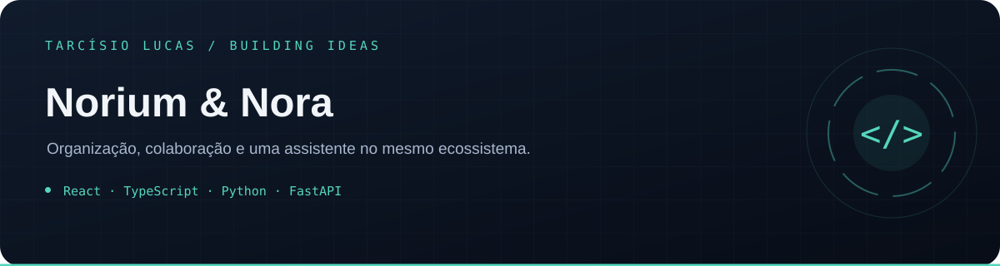

<p align="center"></p>

<p align="center"><a href="https://github.com/T-Lucas43">Perfil</a> · <a href="https://github.com/T-Lucas43?tab=repositories">Mais projetos</a> · <a href="https://www.linkedin.com/in/tarcisio-lucas-io">LinkedIn</a></p>

---

# Norium & Nora

Ecossistema web de organização e colaboração com interface React e backend Python. A Nora faz parte das experiências de assistência da plataforma.

## Estrutura

| Diretório | Conteúdo |
| --- | --- |
| `norium-front-end/` | Interface React, TypeScript e Vite |
| `norium-back-end/` | API Python/FastAPI e testes |
| `infra/` | Referências de infraestrutura |
| `docs/` | Documentação técnica e operacional |

## Desenvolvimento

Comece pelos exemplos de ambiente de cada serviço e pela documentação em `docs/`. Use credenciais próprias e dados de demonstração.

Frontend:

```sh
cd norium-front-end
npm ci
npm run dev
```

O backend declara dependências em `norium-back-end/requirements.txt`. Integrações externas exigem configuração própria; a presença de código não comprova ativação de serviços ou disponibilidade comercial.

## Documentação

- [Segurança](SECURITY.md)
- [Governança de IA](docs/AI_GOVERNANCE.md)
- [Histórico](CHANGELOG.md)
