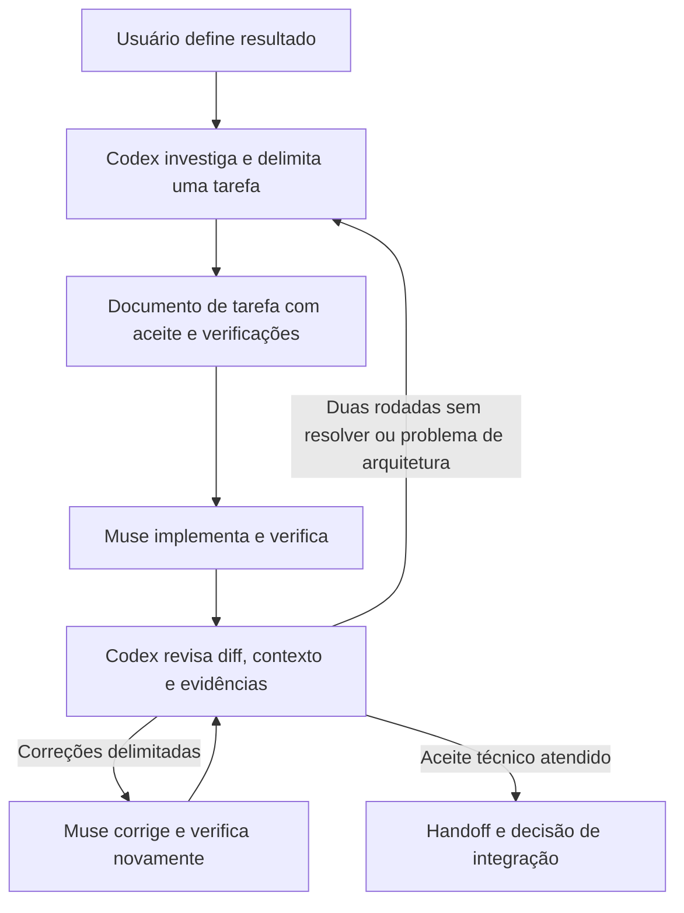

# Fluxo de teste — Codex + Muse Code

Estado: piloto encerrado pelo usuário em 22/09/2026; assinatura Muse Code cancelada. Este documento preserva o procedimento e o aprendizado, sem definir tarefa ativa nem autorização para retomada.
Escopo: implementação assistida no Norium. Não altera o provedor de IA do produto Nora.

## Fluxo



## Responsabilidades e passagem

1. Codex investiga o código atual e define um único resultado verificável, escopo, contratos, critérios de aceite e ponto de parada. O plano deve deixar decisões locais de implementação ao Muse.
2. Crie `docs/handoffs/AAAA-MM-DD-muse-assunto.md` usando o modelo abaixo. Esse arquivo concentra plano, entrega, revisão e resultado da tarefa; não espalhe estado entre PLAN.md, TASKS.md e AGENTS.md.
3. Registre branch, commit e alterações locais relevantes antes de começar. Preserve mudanças alheias. Não use reset, clean, stash ou commits abrangentes para preparar o teste.
4. Use uma branch de tarefa quando apropriado; se houver execução simultânea, use checkouts separados com a mesma base. Worktrees não copiam mudanças não commitadas: registre e transfira apenas as dependências necessárias antes de delegar.
5. Entregue ao Muse o caminho do documento. A passagem inicial pode ser manual; este procedimento não instala ferramentas nem automatiza comunicação entre agentes.
6. Muse lê as regras do repositório e apenas as fontes necessárias, implementa, executa verificações e registra os resultados reais. Incerteza arquitetural ou conflito com trabalho existente retorna ao Codex; escolhas rotineiras não exigem nova aprovação.
7. Codex revisa critérios de aceite, diff completo da tarefa, contexto afetado e evidências. Enumera correções com localização, motivo e resultado esperado. Revisão não substitui teste.
8. Muse corrige; após duas rodadas sem resolver, Codex diagnostica ou reduz o escopo. Não prolongue um ciclo de tentativas sem nova evidência.
9. Encerre com handoff. Integração, publicação e ações externas seguem a autorização vigente e as regras do projeto; o piloto não autoriza deploy ou push por si só.

## Unidade de trabalho e checkpoints

- Uma delegação só começa quando `AGENTS.md`, este workflow e o handoff indicado existem e podem ser lidos no checkout em que o Muse trabalhará. Prepare o pacote antes de modificar código se qualquer ponteiro estiver ausente, não rastreado ou disponível apenas em outro worktree.
- Cada handoff tem um resultado observável. Quando o pedido reúne comportamentos independentes, separe-os em tarefas e revisões próprias. Um fluxo sensível pode ser dividido entre extração, consulta, transição de estado, geração de documento e publicação.
- Antes de editar um fluxo sensível, trace a jornada pública do usuário até persistência, autorização, auditoria e resposta. Helpers e endpoints isolados não demonstram que a jornada funciona.
- Declare separadamente **condições de entrada** e **portões de conclusão**. Testes verdes são normalmente portão de conclusão: um teste vermelho conhecido orienta a correção e não impede seu início.
- Uma rodada altera apenas o necessário para um conjunto enumerado de achados. Após duas rejeições pelo mesmo invariante, pare a implementação, produza uma reprodução mínima e devolva o diagnóstico ao Codex.
- Divida uma release em checkpoints: preparar o checkout; transferir e revisar; verificar; criar commit e PR; acompanhar checks; fazer merge e verificar deploy. Cada prompt executa um checkpoint e termina com evidência observável.

## Contrato operacional do Muse

- Ao iniciar ou retomar, leia somente a seção marcada como rodada atual e as fontes citadas nela. Informe branch, HEAD, arquivos sujos, objetivo único e ponto de parada antes de editar.
- Toda retomada em nova sessão é autossuficiente: inclua checkout, branch, base, origem, destino, caminhos permitidos, estado staged/unstaged, verificações já aceitas e próximo comando. Não use “prompt anterior”, memória da conversa ou um handoff ausente no novo checkout como fonte indispensável.
- No piloto ACP para Windows, faça uma chamada de ferramenta por vez e um comando de shell por chamada. Use o executável ou wrapper fornecido e aguarde resultado e aprovação. Não use `;`, `&&` ou `|` para agrupar etapas. Esta restrição existe enquanto o adaptador apresentar falhas de replay.
- Quando o prompt fornece uma lista exata de arquivos ou um comando de retomada, execute essa lista primeiro. Procure outra fonte apenas se houver contradição concreta e reporte a diferença exata.
- Informe progresso após cada marco e, em trabalho longo, pelo menos a cada dez minutos. Uma atualização relata objetivo concluído, evidência, próximo passo ou bloqueio; atividade genérica não conta como progresso.
- Um comando normalmente instantâneo sem evento novo por cinco minutos indica sessão travada. Cancele o turno, confira o estado no disco e retome em sessão nova com pacote autossuficiente. Após a segunda ocorrência no mesmo adaptador, use o Muse CLI direto. Não envie uma mensagem de teste enquanto houver turno ou aprovação em andamento.
- Se o host alegar aprovação pendente sem mostrar a caixa na interface, trate como falha do adaptador: cancele a sessão e preserve o estado. Não interprete silêncio como aprovação e não reduza sandbox ou permissões.
- Após duas falhas ambientais idênticas, registre comando, erro e evidência; execute a verificação pelo caminho externo autorizado ou devolva o bloqueio. Não repita indefinidamente a mesma tentativa.

Para preparação e recuperação no Windows, consulte [runbook do Muse no Zed](muse-windows-zed-runbook.md). O retrospecto de 22/09/2026 registra a origem destas regras em [análise do piloto](codex-muse-retrospective-2026-09-22.md).

## Publicação pelo Muse

Um pedido explícito do usuário para publicar uma entrega tecnicamente aprovada autoriza o Muse a conduzir a release pelo mesmo caminho usado pelo Codex: PR para `main`, validação do GitHub Actions, merge e deploy automático da imagem imutável no Azure Container Apps. A fase de implementação em `muse.md` continua parando para revisão; a publicação é uma tarefa separada, registrada no handoff da release. Não use o checkout misto de implementação nem uma branch antiga diretamente como fonte de deploy.

1. Verifique `gh auth status`, `git status`, o remoto e a base atual. Se a checagem de login falhar apenas dentro do sandbox, repita-a com a aprovação normal para acesso à rede; só peça ao usuário para renovar o login se também falhar fora dele. Não cole tokens em arquivos, prompts ou logs. Mantenha aprovação de ferramentas e sandbox ativos. Não use `--yolo`, `--disable-approval` ou `--disable-sandbox` para contornar bloqueios.
2. Prepare checkout isolado a partir do `origin/main` atual. Transfira somente os arquivos e dependências da entrega aceita; preserve alterações alheias. Revise o diff completo, os conflitos e a lista de arquivos antes de criar commit. Não faça `reset`, `clean`, `stash` ou commit abrangente no checkout de implementação.
3. Execute os testes pertinentes e os gates de segurança locais disponíveis, registrando resultados reais. Crie PR para `main` com escopo, evidências, riscos e plano de reversão. Aguarde os checks obrigatórios do PR; uma falha deve ser corrigida ou documentada antes do merge, sem desativar gates.
4. Após os checks verdes e as aprovações exigidas pela proteção de branch, faça merge apenas da PR aprovada. O push em `main` aciona `.github/workflows/azure-container-apps.yml`: valida backend/frontend e segurança, publica imagem `sha-<commit>`, aplica essa imagem no Azure via OpenID Connect e verifica `/health`. O workflow também aceita `workflow_dispatch` para validação manual, mas os jobs de release e publicação exigem `refs/heads/main`; não use disparo manual para publicar uma branch nem envie a imagem `latest` manualmente.
5. Confirme o SHA integrado, a conclusão do workflow, a referência da imagem ativa e `/health`; faça uma verificação funcional curta da mudança. Registre PR, commit, execução do Actions, imagem e resultado no handoff. Se a publicação falhar, interrompa novas alterações e reporte o estado; reversão usa a imagem imutável anterior conforme o procedimento de release.

Consulte checks e registre o estado do checkpoint. Se ainda estiverem pendentes, encerre o turno e retome quando houver mudança; não mantenha um turno ACP aberto apenas observando indefinidamente. A autorização de publicação já concedida continua válida entre checkpoints.

O Muse precisa de permissão de escrita no GitHub para PR/merge, mas não de credenciais Azure locais: o GitHub Actions já usa OpenID Connect e variáveis/segredos configurados no repositório. A proteção da branch e as aprovações do Muse continuam valendo.

A condição de `main` no YAML protege este workflow, mas um workflow alterado em outra branch pode remover sua própria condição. Antes de tratar isso como fronteira de segurança do deploy, confirme no Azure que a credencial federada aceita somente a referência `refs/heads/main`, como previsto em `infra/azure/configure-github-oidc.ps1`, e restrinja o ambiente GitHub de produção à mesma branch quando aplicável.

## Aplicação no Norium

- Leia [governança de IA](../AI_GOVERNANCE.md) para trabalho assistido por IA e os contratos pertinentes ao módulo. Use dados sintéticos; não inclua segredos nem dados de produção no pacote de tarefa.
- Frontend: scripts de teste, lint e build estão em `norium-front-end/package.json`; selecione os necessários para a mudança e registre comando, diretório e resultado.
- Backend: selecione os testes existentes em `norium-back-end/tests` e as verificações de segurança pertinentes. Não invente comando de teste ou declare validação que não executou.
- Mudanças em WhatsApp consultam `CONTEXT.md` e o documento do assunto em `docs/architecture/`. Preserve isolamento entre tenants, contratos e tratamento de resultados desconhecidos.
- Comece por uma tarefa sem alterar autenticação, pagamentos, dados de produção ou infraestrutura. A governança existente continua valendo para código crítico.

## Modelo de tarefa e entrega

Copie esta seção para o handoff da tarefa e preencha antes de executar:

```markdown
# Piloto Muse — <assunto>

## Rodada atual

- Estado: planejado / em execução / em revisão / com pendências / verificado.
- Pedido e autorização:
- Resultado esperado e ponto de parada:
- Branch, commit-base e arquivos locais necessários:
- Alterações preexistentes que devem ser preservadas:
- Condições de entrada:
- Portões de conclusão:
- Fontes e regras pertinentes (links relativos):
- Escopo permitido e fora de escopo:
- Contratos e decisões já definidos:
- Jornada pública e efeitos que devem ser observados:
- Manifesto de transferência (origem, destino e caminhos exatos), quando houver:
- Critérios de aceite observáveis:
- Verificação prevista (comando, diretório, resultado esperado):

## Entrega do Muse
- Arquivos alterados e motivo:
- Verificações executadas, resultados e caminhos das evidências:
- Verificações não executadas e motivo:
- Pendências ou decisões que exigem Codex:

## Revisão do Codex
- Aceites atendidos e falhas encontradas:
- Correções solicitadas e rodada atual:
- Resultado da nova verificação:

## Encerramento
- Branch/commit final, ou arquivos ainda não commitados:
- Tempo de intervenção humana e de revisão:
- Franquia antes/depois, modelo e ferramenta; desconhecido se não disponível:
- Resultado: aceito / retrabalho / bloqueado; motivo:
- Próximo marco único:

## Histórico encerrado
- Rodadas anteriores, com decisão e evidência resumidas:
```

## Avaliar o piloto

O piloto foi encerrado após as tarefas de agenda, notificações e PDF/Nora. As tarefas 1 e 2 foram integradas; a tarefa 3 foi integrada pela PR #31 após várias rodadas técnicas e alta intervenção operacional. O [retrospecto de 22/09/2026](codex-muse-retrospective-2026-09-22.md) registra o resultado e as falhas. A assinatura adicional foi cancelada; nenhuma tarefa nova deve ser enviada ao Muse sem decisão explícita do usuário.

## Modelo de prompt de correção

Use este modelo somente quando a revisão do Codex encontrar falhas. Preencha todos os campos com fatos verificados; não delegue ao Muse a descoberta do que já foi apurado. Se a entrega estiver correta, registre o aceite sem criar trabalho artificial.

```markdown
Corrija somente a rodada <número> de <handoff>, no checkout <caminho> e branch <branch>.

Contexto confirmado:
- HEAD/base:
- Estado staged/unstaged e alterações preexistentes a preservar:
- Resultado único desta rodada:
- Ponto de parada: devolver diff e evidências para revisão; não fazer commit, push, PR, merge ou deploy, salvo autorização explícita deste checkpoint.

Achados obrigatórios:
1. <arquivo:linha ou jornada afetada> — <comportamento observado>.
   - Causa confirmada ou hipótese a testar:
   - Resultado esperado:
   - Regressão que deve permanecer funcionando:
2. <repita para cada falha real>.

Limites:
- Arquivos permitidos:
- Fora de escopo:
- Contratos de autorização, tenant, privacidade, auditoria e idempotência que não podem regredir:
- Não reformatar nem reescrever áreas alheias; não adicionar dependência sem necessidade demonstrada.

Ordem obrigatória:
1. Confirme branch, HEAD, arquivos sujos e reproduza cada falha.
2. Faça a menor correção coerente que resolva todos os achados enumerados.
3. Execute <testes focados> e depois <gate de conclusão> em <diretório>.
4. Revise o diff inteiro e `git diff --check`.
5. Registre arquivos alterados, resultados reais, verificações não executadas e risco restante; pare para revisão do Codex.

No ACP, faça uma chamada de ferramenta e um comando por vez, usando <wrapper/comando exato>. Não use separadores de shell. Se o mesmo bloqueio ambiental ocorrer duas vezes, pare e reporte comando, erro e estado no disco. Não afrouxe sandbox, aprovações, autenticação ou TLS.
```

## Texto para iniciar no Muse

> Leia `AGENTS.md`, `docs/workflows/codex-muse.md` e somente a seção **Rodada atual** de `<handoff>`. Antes de editar, informe branch, HEAD, arquivos sujos, resultado único, condições de entrada e portões de conclusão. Execute um checkpoint por vez, preserve alterações existentes e registre diff e verificações reais. Pare no ponto indicado para revisão do Codex. Se faltar uma decisão indispensável, registre a evidência e avance apenas no trabalho independente.

## Modelo de retomada autossuficiente

```markdown
Retome somente o checkpoint <nome>.

- Checkout e branch:
- HEAD/base confirmados:
- Origem e destino, se houver:
- Estado staged/unstaged:
- Caminhos permitidos:
- Caminhos excluídos:
- Evidências já aceitas, que não devem ser repetidas:
- Próximo comando exato:
- Critério de conclusão deste turno:
- Ponto de parada:

Faça uma chamada de ferramenta e um comando por vez. Aguarde resultado e aprovação antes de continuar. Informe progresso a cada marco.
```
